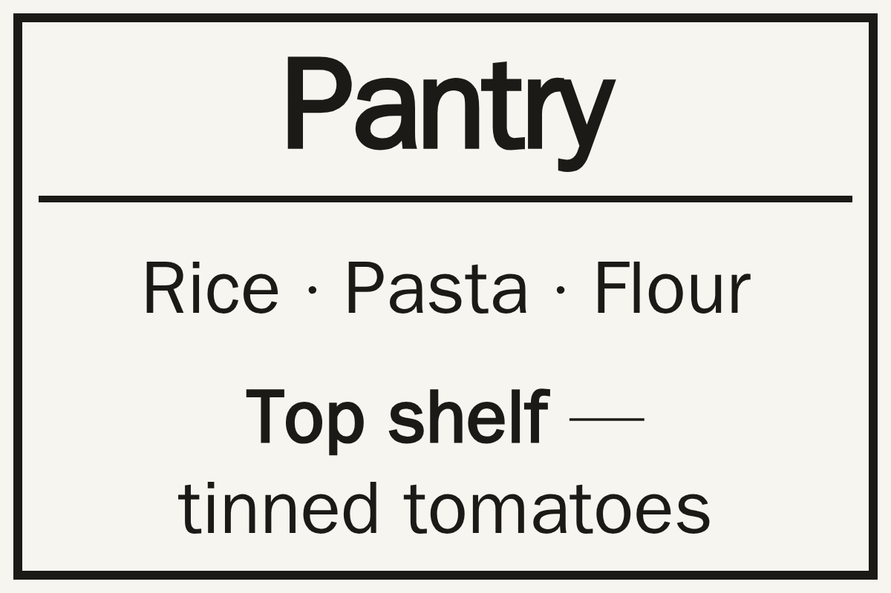
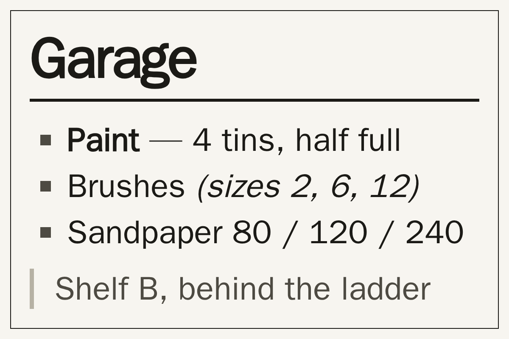
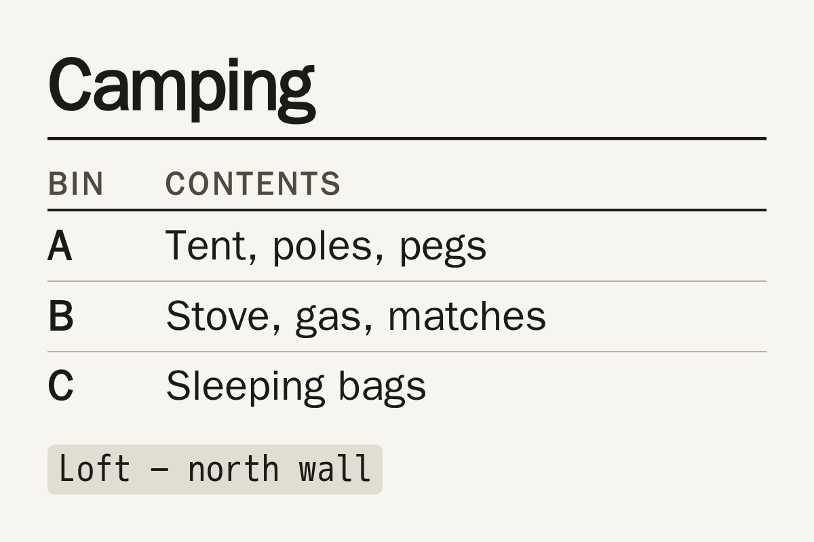
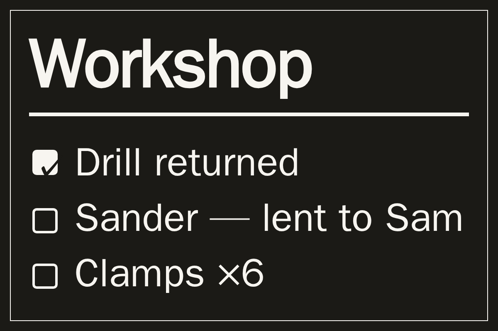
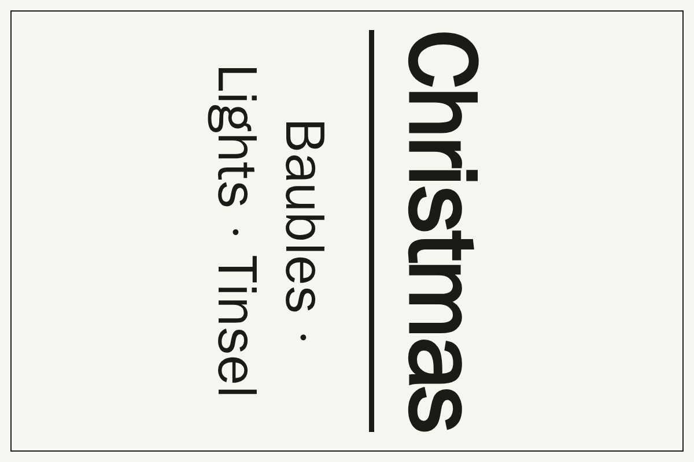

# markdown_note

Write markdown, get a note, a sign, or an **e-ink shelf label** — for
[Tesserae](https://github.com/dmellok/tesserae) panels.



Type the markdown into the cell, or point *many* cells at **one markdown
document** and give each one a section. Relabelling twenty storage bins then
means editing one file, not visiting twenty dashboards.

## Two ways to feed it

**Inline.** Put the markdown in the cell's *Markdown* box. That's the whole
setup.

**One document, many labels.** Set *Document URL* to a raw gist (or a raw
GitHub file, a Nextcloud share, any plain-text endpoint) and give each cell a
*Section*:

```markdown
# Pantry
Rice · Pasta · Flour

---

# Garage
Paint · Brushes · Sandpaper

---

# Craft
Yarn · Felt · Glue gun
```

Three cells, all pointing at that URL, with *Section* set to `Pantry`,
`Garage` and `Craft`. Edit the gist, and every tag follows on its next refresh.

Sectioning rules, in order:

1. If the document has `---` rules at the top level, it splits there. Rules
   inside a fenced code block don't count.
2. Otherwise it splits at the shallowest heading level that appears more than
   once (so a document of `#` sections, or of `##` sections, both work).
3. Otherwise the whole document is one section.

A section is addressed by its heading text — case, spacing and punctuation are
ignored, so `Craft supplies`, `craft supplies` and `CRAFT-SUPPLIES` all match —
by an unambiguous prefix, or by its number (`3`). Blank shows the whole
document. Name one that isn't there and the label tells you which names *are*,
which is the message you want when you're wiring up twenty of them.

The document is cached per URL on the *Re-read* interval, and a failed refresh
keeps serving the last good copy: a tag showing yesterday's (identical) text
beats a tag showing nothing.

## Markdown it renders

Headings, **bold**, *italic*, ~~strike~~, `code`, ==highlight==, fenced code
blocks, bullet and numbered lists (nested), `- [ ]` / `- [x]` task boxes,
blockquotes, tables, horizontal rules, links (drawn as their text) and images.

A typed newline breaks the line by default, because that is what someone
writing a shelf tag means. Set *Line breaks* to **Reflow** for prose that was
already hard-wrapped at 80 columns.

## Options (per cell)

| Option         | Default | Meaning                                                             |
| -------------- | ------- | ------------------------------------------------------------------- |
| `text`         | sample  | The markdown, when no document URL is set.                          |
| `source_url`   | —       | Fetch the markdown from a URL instead.                              |
| `section`      | —       | Which part of the document this cell shows.                         |
| `line_breaks`  | `typed` | `typed` breaks on every newline; `reflow` only on a blank line.     |
| `layout`       | `label` | `label` fills the tag edge to edge; `page` uses document margins.   |
| `text_size`    | `auto`  | `auto` measures and fills the cell; or pin `xs`–`xl`.               |
| `align`        | `left`  | Left, centre, right.                                                 |
| `valign`       | `middle`| Top, middle, bottom.                                                 |
| `density`      | `normal`| Margin size: tight, normal, roomy.                                   |
| `frame`        | `none`  | None, hairline, or a bold rule around the tag.                       |
| `invert`       | `false` | Light type on black.                                                 |
| `rotate`       | `0`     | 0 / 90 / 180 / 270°, for tags mounted sideways on a shelf lip.       |
| `refresh_min`  | `15`    | How often to re-read the document.                                   |

Fragments: `heading` (the title alone) and `body` (everything under it), for
composing on a canvas.

## How it looks

| | |
| --- | --- |
|  |  |
|  |  |

## How it works

`client.js` owns the rendering, parser included. Inline text has to render even
when the server has nothing to add, and one renderer for both modes means the
preview in the editor is the tag on the shelf.

**Auto-fit measures rather than guesses.** A tag is small and the text is
arbitrary — "Pantry" versus a six-line inventory — so a fixed `clamp()` is
either tiny or clipped. The widget seeds a size from the cell's area and the
text length, then binary-searches the largest size that doesn't overflow,
re-running once the page's webfont has loaded (the first pass measures in the
fallback face, whose metrics are not the ones that get screenshotted). Words
stay whole while it searches, so a heading shrinks rather than splitting into
`Wint / er`.

**Rotation** is a real transform on a stage sized to the container's swapped
dimensions, so the frame and the margins turn with the text.

`server.py` fetches and splits the document, and returns the markdown for the
chosen section (plus `title`, `body`, `section`, `sections`, `count`) for
binding on a canvas. It renders no HTML.

## Install (from the catalog)

Open **Settings → Widgets → Browse** in Tesserae and search for *Markdown
Note*.

## Manual install (development)

```sh
cp -r /path/to/this/repo /path/to/tesserae/data/plugins/markdown_note
```

## Egress

`requires: ["network:*"]`, because the document URL is whatever you point it
at. With no *Document URL* set, the widget makes no network calls at all.

## License

AGPL-3.0-or-later, same as Tesserae.
